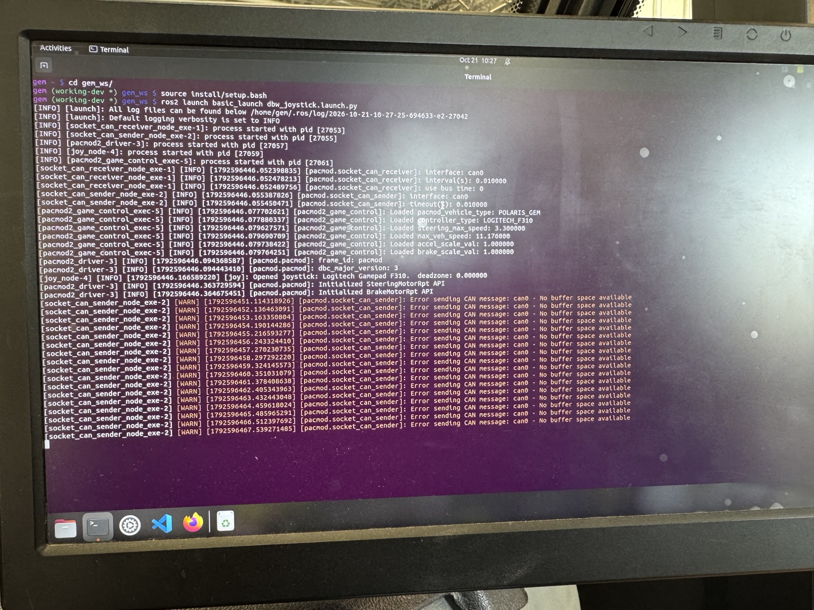
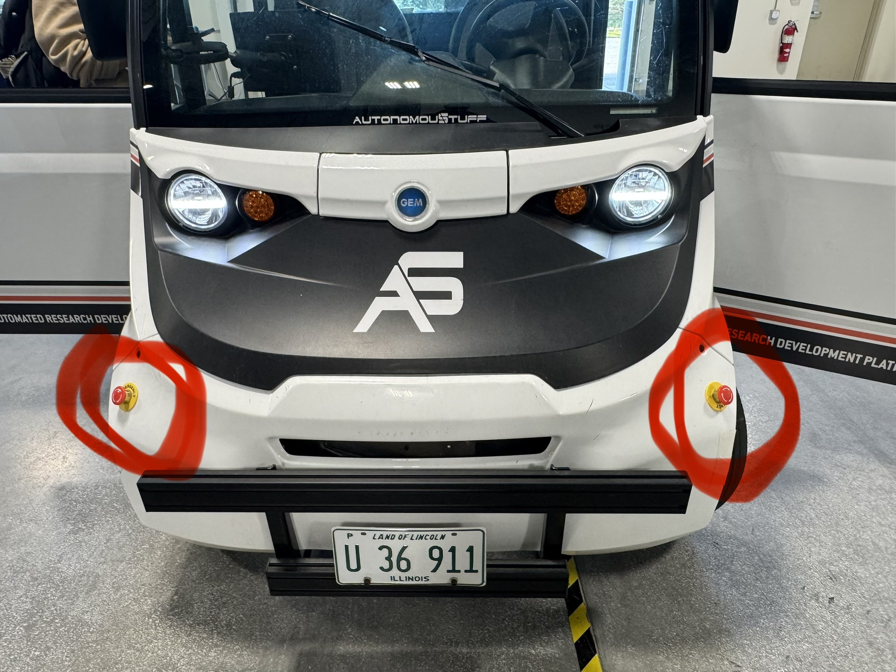
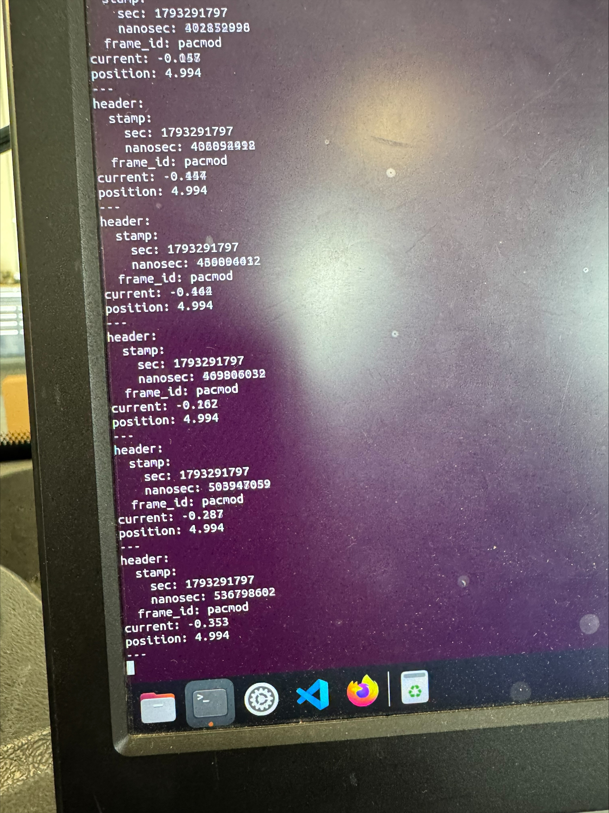
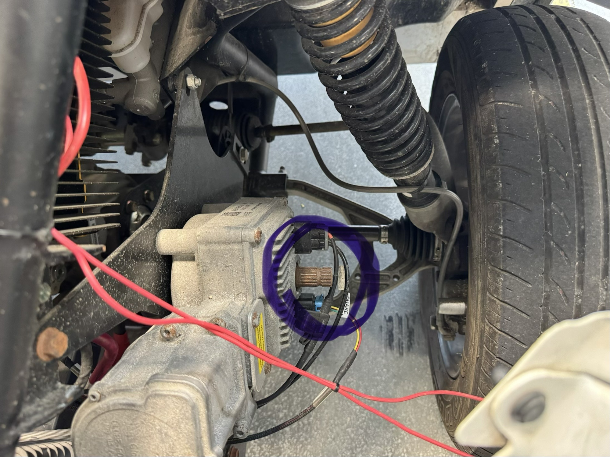
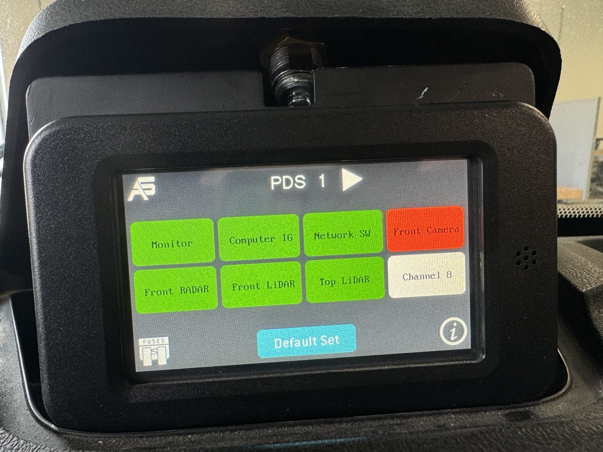
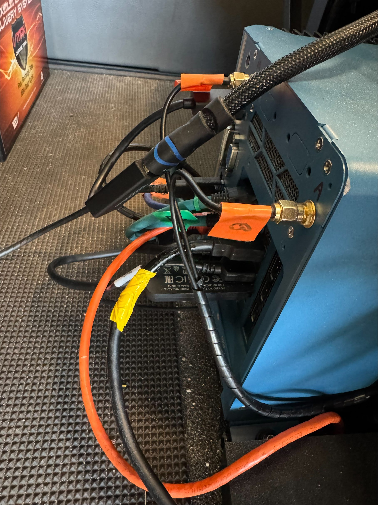

# Troubleshooting Guidelines

This document provides guidance for troubleshooting common issues encountered when using the GEM car.

## Drive-by-wire showing CAN Buffer Warning

If you run Joystick control but the GEM car does not respond and you see this CAN Buffer warning message in the terminal, it indicates that the drive-by-wire system is not receiving commands from the joystick. 


### Possible Solutions

1. Check all the emergency buttons inside and outside the GEM car. If any of the emergency button is pressed, rotate it to release the emergency state.


## Drive-by-wire Not Responding

If you do not see any error/warning messages yet the GEM car does not respond to joystick commands, check the brake motor position from this ros topic. If it is not close to 5.0, you may need to adjust it.
```bash
ros2 topic echo /pacmod/brake_motor_rpt_1
```


Take off the front cover to access the motor shaft. You can rotate the motor shaft position by hand as shown in the image. Make sure the position is close to 5.0.



## E4 Front Camera Button is Red

If the E4 `Front Camera` button is red, it indicates that the camera is not functioning properly or is not connected.



### Possible Solutions

1. Unplug the Oak camera usb cable from the computer. This is marked as the yellow cable in this image. 
2. Now you should be able to click on the `Front Camera` button, and it should turn green indicating that the camera is functioning properly.
3. Plug the Oak camera usb cable back into the computer. The `Front Camera` button should remain green if the camera is functioning properly.

## Computer Not Booting

If the computer turns on and but gets stuck in `/dev/sda2: clean,....` screen and does not boot into the desktop environment, it indicates that the memory might be full. While this screen is up, press ctrl + alt + F3 to switch to a terminal interface where you can log in and check the disk usage.

### Possible Solutions

1. Log in to the terminal interface using your username (gem) and password (gem_ros2).
2. Check the disk usage with the command `df -h` to identify if any `/dev/sda2` partition is full. We need 2Gb+ of free space.
3. If the root partition is full, consider deleting unnecessary files or moving them to an external storage device.
4. After freeing up space, reboot the computer with the command `sudo reboot`.
